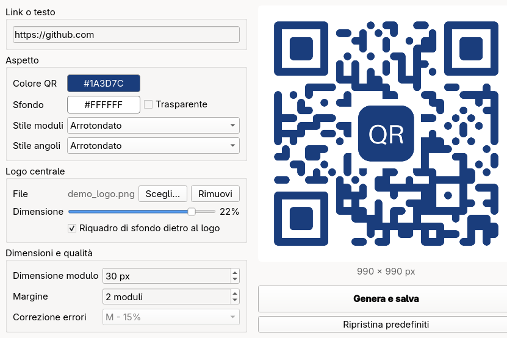

<p align="center">
  
</p>

<h1 align="center">QR Generator</h1>

<p align="center">
  Piccola app desktop per creare QR code personalizzati in pochi secondi:<br>
  incolli il link, scegli colori, stile e logo, clicchi <b>Genera e salva</b>.
</p>

<p align="center">
  
  
  
</p>

<p align="center">
  
</p>

---

## Perché

Generare un QR code "fatto bene" (con i colori del brand, il logo al centro, lo
sfondo trasparente per metterlo su una grafica) di solito significa aprire un
sito pieno di pubblicità o un notebook, cambiare parametri a mano, esportare.
QR Generator fa tutto in una finestra, con l'anteprima che si aggiorna mentre
scrivi, e ricorda le tue impostazioni per la volta successiva.

## Funzionalità

- **Anteprima in tempo reale** mentre scrivi il link o cambi un'opzione
- **Colori** del QR e dello sfondo, oppure **sfondo trasparente**
- **6 stili per i moduli**: quadrato, arrotondato, quadrato distanziato, cerchi, barre verticali, barre orizzontali
- **2 stili per gli angoli** (finder pattern): quadrato e arrotondato
- **Logo centrale** con dimensione regolabile e riquadro di sfondo allineato alla griglia
- **Dimensione dei moduli, margine e livello di correzione errori** regolabili
- **Esportazione** in PNG, JPG o WebP (premi <kbd>Invio</kbd> nel campo del link per salvare al volo)
- **Impostazioni ricordate** tra un avvio e l'altro, con il pulsante **Ripristina predefiniti** per tornare ai valori iniziali
- Nome file proposto in automatico dal dominio (es. `qr_github.com.png`)

## Versione web (anche da telefono)

👉 **[alemazz99.github.io/qrcode_generator](https://alemazz99.github.io/qrcode_generator/)**

La stessa app, con le stesse opzioni e gli stessi limiti di leggibilità, gira
direttamente nel browser: niente da installare, funziona su telefono, tablet e PC.
Il QR viene generato sul dispositivo, quindi link e logo non vengono inviati a nessun server.

Per averla come un'app sul telefono, aprila e aggiungila alla schermata Home:

- **Android (Chrome)**: menu <kbd>⋮</kbd> → *Aggiungi a schermata Home* (o *Installa app*)
- **iPhone (Safari)**: pulsante *Condividi* → *Aggiungi alla schermata Home*

Da lì si apre a schermo intero e funziona anche **offline**. Sul telefono il
pulsante **Condividi** permette di salvare il QR direttamente nelle foto o di
mandarlo in chat.

## Requisiti

- Python **3.10** o superiore
- Le dipendenze in [`requirements.txt`](requirements.txt): [PySide6](https://doc.qt.io/qtforpython-6/) e [qrcode](https://github.com/lincolnloop/python-qrcode) (con Pillow)

Sviluppata e provata su **Linux** (Fedora Silverblue, GNOME su Wayland). Le librerie
usate sono multipiattaforma, quindi dovrebbe funzionare anche su Windows e macOS,
ma lì non è stata testata.

## Installazione e avvio

```bash
git clone https://github.com/Alemazz99/qrcode_generator.git
cd qrcode_generator
./run.sh
```

Al primo avvio `run.sh` crea un ambiente virtuale in `.venv/` e installa le
dipendenze; dalle volte successive parte subito.

<details>
<summary><b>Avvio manuale (Windows, macOS o se preferisci non usare lo script)</b></summary>

```bash
python3 -m venv .venv
.venv/bin/pip install -r requirements.txt     # Windows: .venv\Scripts\pip install -r requirements.txt
.venv/bin/python app.py                       # Windows: .venv\Scripts\python app.py
```

</details>

<details>
<summary><b>Usarla dentro un distrobox (Fedora Silverblue / sistemi immutabili)</b></summary>

Se hai un [distrobox](https://distrobox.it/) chiamato `python`, `run.sh` lo
rileva da solo e avvia l'app lì dentro: sull'host non viene installato nulla.
Per usare un container con un altro nome, o per disattivare il comportamento:

```bash
QRGEN_CONTAINER=mio-container ./run.sh   # usa un altro distrobox
QRGEN_CONTAINER= ./run.sh                # avvio diretto, senza container
```

Il container deve avere accesso al display (distrobox lo fa di default).

</details>

### Aggiungerla al menu applicazioni (Linux)

```bash
./install-launcher.sh
```

Crea `~/.local/share/applications/qrcode-generator.desktop`, così "QR Generator"
compare tra le applicazioni di GNOME/KDE con la sua icona. Per rimuoverla basta
cancellare quel file.

## Uso da codice

La generazione vive in [`qr_core.py`](qr_core.py), separata dall'interfaccia,
quindi puoi usarla anche in uno script o in un altro progetto:

```python
from qr_core import QrOptions, generate, save

opts = QrOptions(
    data="https://github.com",
    fg_color="#1a3d7c",
    transparent=True,
    module_style="Arrotondato",
    logo_path="logo.png",
    logo_ratio=0.22,
)
img = generate(opts)          # PIL.Image in RGBA
save(img, "qr_github.png")    # .png / .jpg / .webp
```

| Opzione        | Default      | Descrizione                                                          |
| -------------- | ------------ | -------------------------------------------------------------------- |
| `data`         | -            | Link o testo da codificare                                           |
| `fg_color`     | `#000000`    | Colore dei moduli                                                    |
| `bg_color`     | `#ffffff`    | Colore di sfondo (usato anche per appiattire i JPG)                  |
| `transparent`  | `False`      | Sfondo trasparente                                                   |
| `module_style` | `Quadrato`   | Una delle chiavi di `MODULE_STYLES`                                  |
| `eye_style`    | `Quadrato`   | Una delle chiavi di `EYE_STYLES`                                     |
| `box_size`     | `30`         | Pixel per modulo                                                     |
| `border`       | `2`          | Margine, in moduli                                                   |
| `error_level`  | `M - 15%`    | Una delle chiavi di `ERROR_LEVELS` (ignorato se c'è un logo)         |
| `logo_path`    | `None`       | Immagine da mettere al centro                                        |
| `logo_ratio`   | `0.22`       | Lato del logo rispetto al QR, massimo `MAX_LOGO_RATIO` (0.24)        |
| `logo_padding` | `True`       | Svuota un riquadro dietro al logo                                    |

I valori di default di `QrOptions` sono anche quelli che l'app ripristina con
**Ripristina predefiniti**: per cambiarli basta modificare la dataclass.

## Leggibilità: le scelte fatte

Un QR code personalizzato è utile solo se il telefono lo legge. Per questo alcune
opzioni hanno dei limiti voluti, verificati decodificando centinaia di varianti con
[ZXing](https://github.com/zxing-cpp/zxing-cpp) e OpenCV e provando con smartphone reali:

- **Con un logo la correzione errori passa sempre a H (30%)**: il logo copre una
  parte dei moduli e serve la ridondanza massima per recuperarli.
- **Il logo non può superare il 24% del lato**: dal 25% in su i telefoni smettono
  di riconoscere il codice.
- **Gli angoli sono solo pieni** (quadrato o arrotondato): con cerchi o quadrati
  staccati i lettori non trovano più i *finder pattern* e il QR diventa illeggibile.
  Lo stile "creativo" resta disponibile per i moduli, dove non crea problemi.
- **Il riquadro dietro al logo è allineato alla griglia**, così nessun modulo resta
  tagliato a metà.

Consiglio comunque di provare sempre il QR con un telefono prima di stamparlo,
soprattutto con colori chiari su sfondo chiaro, con sfondo trasparente o con
**link lunghi insieme a un logo**: più il link è lungo, più il QR è fitto e più
conviene tenere il logo piccolo (o usare un link accorciato).

## Dove vengono salvate le impostazioni

Colori, stili, ultimo logo e cartella di salvataggio vengono ricordati tramite
`QSettings` di Qt:

- **Linux**: `~/.config/qrcode_generator/settings.conf`
- **Windows**: registro, in `HKEY_CURRENT_USER\Software\qrcode_generator\settings`
- **macOS**: `~/Library/Preferences/com.qrcode_generator.settings.plist`

Cancellare quel file (o premere **Ripristina predefiniti**) riporta tutto ai valori iniziali.

Nella versione web le preferenze (e il logo) restano solo nel browser del
dispositivo, nel `localStorage` della pagina.

## Struttura del progetto

```
qrcode_generator/
├── app.py                # Interfaccia grafica desktop (PySide6)
├── qr_core.py            # Generazione del QR, indipendente dalla UI
├── run.sh                # Avvio: crea il venv al primo lancio, usa distrobox se presente
├── install-launcher.sh   # Aggiunge l'app al menu applicazioni (Linux)
├── requirements.txt
├── assets/
│   ├── icon.png
│   └── screenshot.png
└── docs/                 # Versione web, pubblicata con GitHub Pages
    ├── index.html
    ├── app.js            # Interfaccia web
    ├── qr-render.js      # Generazione del QR su canvas: stessa logica di qr_core.py
    ├── sw.js             # Service worker per l'uso offline
    ├── manifest.webmanifest
    ├── style.css
    ├── icons/
    └── vendor/qrcode.js  # qrcode-generator di Kazuhiko Arase (MIT)
```

Se modifichi le regole di generazione (stili, limiti, valori predefiniti), tieni
allineati `qr_core.py` e `docs/qr-render.js`, così app desktop e versione web
producono lo stesso risultato.

Per provare la versione web in locale serve un piccolo server (il service worker
non funziona aprendo il file direttamente):

```bash
python3 -m http.server -d docs 8000   # poi apri http://localhost:8000
```

## Risoluzione problemi

- **L'app non parte in un container minimale / errore su `libEGL`, `libxkbcommon` o
  simili**: le wheel di PySide6 includono Qt ma si appoggiano ad alcune librerie
  grafiche di sistema. Su Fedora: `sudo dnf install mesa-libEGL libxkbcommon fontconfig`
  (su Debian/Ubuntu: `libegl1 libxkbcommon0 fontconfig`).
- **Si apre una finestra enorme o "stirata"**: se usi un window manager a tiling
  (es. Pop Shell) è lui a decidere le dimensioni della finestra all'apertura.

## Licenza

Distribuito con licenza [MIT](LICENSE): puoi usarlo, modificarlo e ridistribuirlo
liberamente, anche per uso commerciale.
